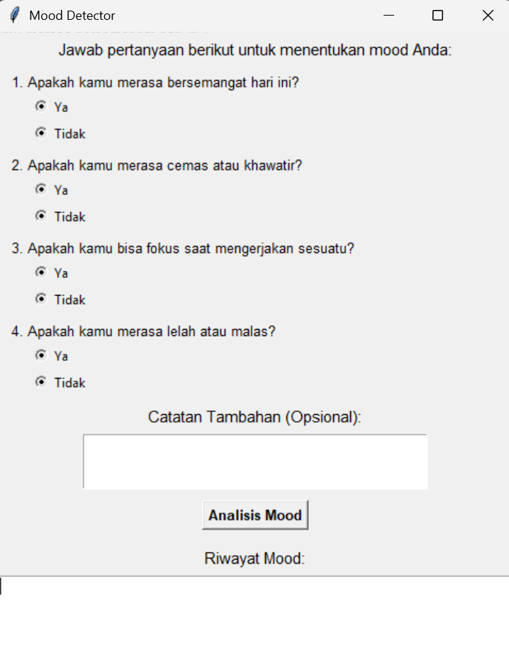
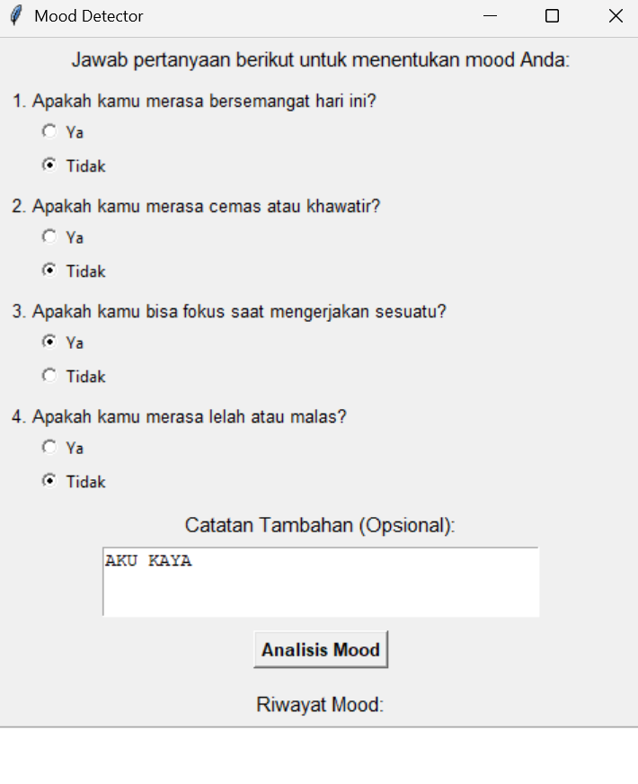
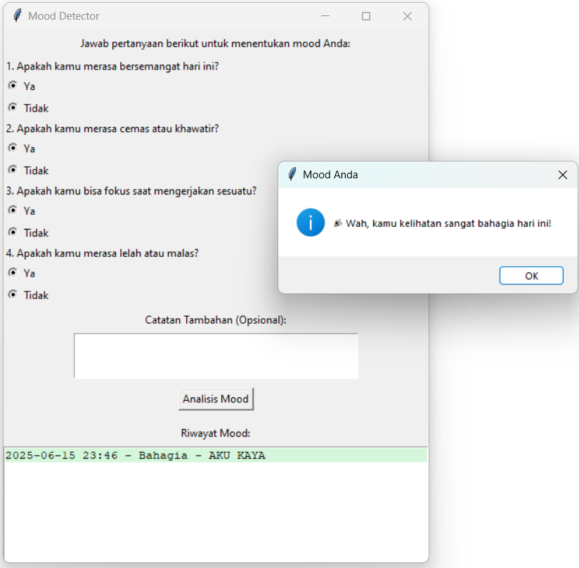

# Dokumentasi Proyek — Mood Detector (PBO)

**Mata Kuliah:** Pemrograman Berorientasi Objek (PBO)  
**Nama Proyek:** Mood Detector  
**Kelompok:** 2  
**Penyusun:** Shifan Windraya Prassasti (24/541727/SV/24944)  
**Program Studi:** D-IV Teknologi Rekayasa Internet — Sekolah Vokasi UGM  

---

## 1. Latar Belakang

Di era modern, kesehatan mental semakin mendapatkan perhatian. Namun banyak orang tidak menyadari kondisi emosi harian mereka. Proyek ini hadir sebagai pendamping harian ringan berbasis pertanyaan sederhana yang dapat membantu pengguna memahami kondisi psikologis mereka secara mandiri.

---

## 2. Tujuan Proyek

- Membangun aplikasi desktop berbasis GUI untuk mendeteksi dan merekam mood pengguna.
- Mengimplementasikan pola arsitektur **MVC (Model-View-Controller)** dalam Python.
- Menerapkan konsep OOP: kelas, objek, enkapsulasi, dan pemisahan tanggung jawab.

---

## 3. Teknologi & Tools

| Komponen | Teknologi |
|----------|-----------|
| Bahasa | Python 3 |
| GUI | `tkinter` |
| Pola Arsitektur | MVC (Model-View-Controller) |
| Library | `datetime` (bawaan Python) |

---

## 4. Penyelesaian / Rancangan Sistem

### Arsitektur MVC

```
MoodModel  ──►  MoodController  ──►  MoodView
(Data)          (Logika Bisnis)       (Tampilan GUI)
```

### Model (`MoodModel`)
- Menyimpan daftar entri mood (`entries`) berupa list of dict.
- Setiap entri memiliki: `date`, `mood`, dan `note`.
- Method: `add_entry(mood, note)` dan `get_entries()`.

### View (`MoodView`)
- Menampilkan **4 pertanyaan** dengan pilihan Ya/Tidak (Radio Button).
  1. Apakah kamu merasa bersemangat hari ini? *(positif)*
  2. Apakah kamu merasa cemas atau khawatir? *(negatif)*
  3. Apakah kamu bisa fokus saat mengerjakan sesuatu? *(positif)*
  4. Apakah kamu merasa lelah atau malas? *(negatif)*
- Kolom catatan tambahan (opsional).
- Riwayat mood dengan warna berbeda per kategori.

### Controller (`MoodController`)
- Mengambil jawaban dari View, menghitung skor, menentukan mood.
- **Sistem Skoring:**
  - Pertanyaan positif (1 & 3): Ya = +1
  - Pertanyaan negatif (2 & 4): Tidak = +1
  - Skor maks = 4

### Logika Penentuan Mood

| Skor | Mood | Respons |
|------|------|---------|
| ≥ 3  | 😄 Bahagia | "Wah, kamu kelihatan sangat bahagia hari ini!" |
| 2    | 🌤 Biasa   | "Hari yang biasa juga tetap berarti." |
| 1    | 💙 Sedih   | "Semoga harimu segera membaik ya." |
| 0    | 🔥 Marah   | "Yuk, tarik napas dan cari hal yang menenangkan." |

---

## 5. Hasil Proyek

- Aplikasi berhasil dibangun dengan tampilan GUI interaktif.


*Gambar 1: Antarmuka Pertanyaan Skoring Mood*


*Gambar 2: Pengisian Pertanyaan dan Catatan Tambahan Pengguna*

- Pengguna menjawab 4 pertanyaan → sistem menganalisis → menampilkan hasil mood.


*Gambar 3: Deteksi Mood Bahagia dan Riwayat Tersimpan dengan Color-Coding*

- Riwayat mood ditampilkan dengan **color-coding**:
  - 🟢 Hijau muda → Bahagia
  - ⬜ Abu-abu → Biasa
  - 🔵 Biru muda → Sedih
  - 🔴 Merah muda → Marah
- Aplikasi mendukung pencatatan catatan tambahan bersama setiap entri mood.
- Desain modular MVC memudahkan pengembangan lebih lanjut (misal: grafik statistik atau penyimpanan data jangka panjang).

---

## 6. Kesimpulan

Proyek Mood Detector berhasil mengimplementasikan pola MVC dalam aplikasi Python-tkinter. Sistem ini mampu mendeteksi kondisi emosi pengguna secara sederhana namun efektif melalui pertanyaan berbasis skor. Aplikasi ini menjadi bukti penerapan konsep OOP yang baik dalam konteks nyata.
