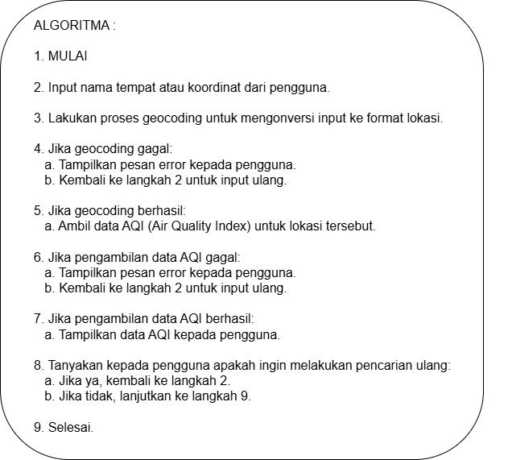
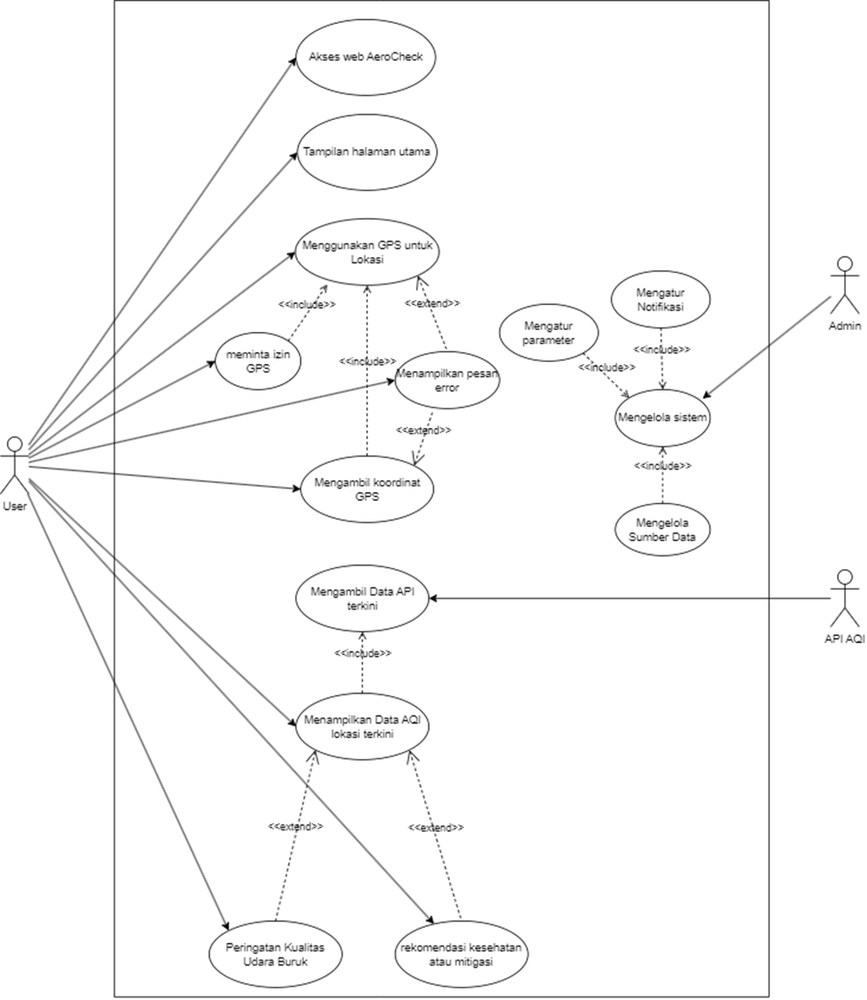
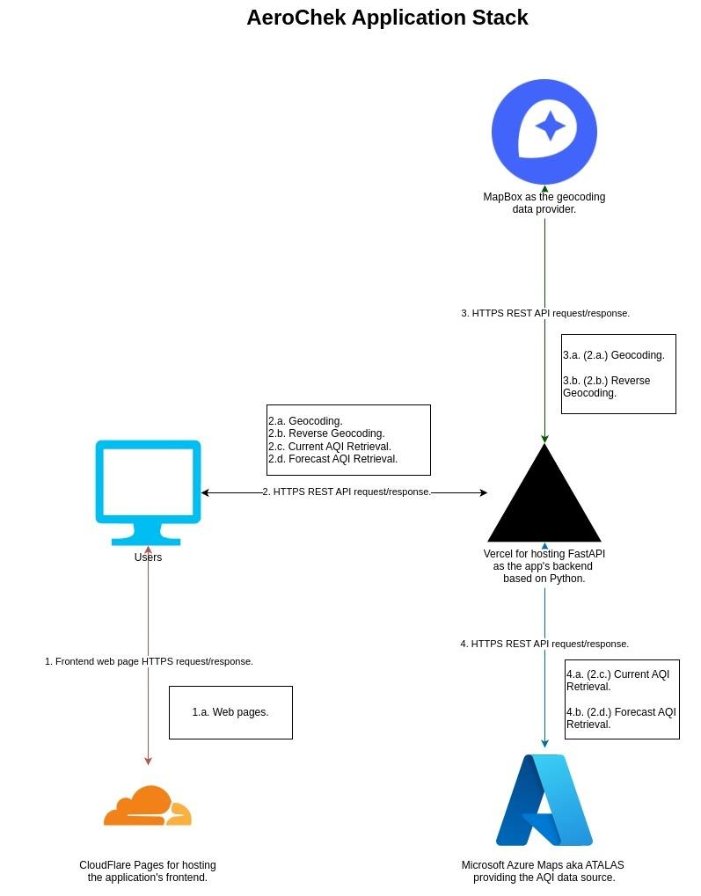

# Dokumentasi Proyek — AeroCheck: Monitoring AQI Berbasis Web (Prokom)

**Mata Kuliah:** Pemrograman Komputer  
**Nama Proyek:** AeroCheck — Monitoring Air Quality Index (AQI) Berbasis Web  
**Kelompok:** 6  
**Anggota:**
1. Chelsa Yoga Permadany
2. Bima Mukhlisin Bil Sajjad
3. Ghaniy Zulianto
4. Muhammad Fathinnur A. A.
5. **Shifan Windraya Prassasti** (24/541727/SV/24944)

**Dosen Pengampu:** Dr. Ronald Adrian, S.T., M.Eng.  
**Program Studi:** D-IV Teknologi Rekayasa Internet — Sekolah Vokasi UGM, 2024  

---

## 1. Latar Belakang

Kualitas udara yang buruk akibat emisi kendaraan bermotor, pembangkit listrik berbasis bahan bakar fosil, aktivitas industri, dan kebakaran hutan berdampak serius pada kesehatan masyarakat—terutama anak-anak dan lansia yang lebih rentan terhadap penyakit pernapasan dan gangguan kognitif. Ketidaktersediaan platform yang mudah diakses untuk memantau kualitas udara secara real-time mendorong tim untuk mengembangkan solusi ini.

---

## 2. Tujuan Proyek

- Membangun platform web pemantau kualitas udara berbasis data AQI real-time.
- Menampilkan data kualitas udara berdasarkan lokasi GPS pengguna.
- Menyediakan prediksi kualitas udara melalui visualisasi grafik.
- Memberikan informasi yang mudah dipahami oleh masyarakat umum.

---

## 3. Teknologi & Tools

| Komponen | Teknologi |
|----------|-----------|
| Bahasa | Python (backend) |
| Frontend | Web (HTML/CSS/JS) |
| Data Source | API AQI real-time |
| Lokasi | GPS Browser API |
| Visualisasi | Grafik prediksi kualitas udara |

---

## 4. Penyelesaian / Rancangan Sistem

### Alur Aplikasi & Flowchart

*Gambar 1: Algoritma dan Flowchart Alur Sistem AeroCheck*

1. User mengakses web AeroCheck.
2. Sistem meminta izin akses GPS → mengambil koordinat lokasi.
3. Data AQI diambil dari API berdasarkan koordinat.
4. Sistem menampilkan indeks kualitas udara dan kategori kondisi.
5. Halaman grafik menampilkan prediksi kualitas udara ke depan.

### Use Case & Application Stack

*Gambar 2: Use Case Diagram Pengguna dan Administrator*

*Gambar 3: Application Stack dan Integrasi Teknologi AeroCheck*

### Use Case Utama

| No | Use Case | Aktor | Deskripsi |
|----|----------|-------|-----------|
| 1 | Akses Web AeroCheck | User | Membuka halaman utama monitoring AQI |
| 2 | Tampilan Halaman Utama | User | Sistem menampilkan dashboard setelah akses |
| 3 | Menggunakan GPS untuk Lokasi | User | Menentukan lokasi untuk data AQI lokal |
| 4 | Meminta Izin GPS | Sistem | Sistem meminta konfirmasi izin lokasi |

### Application Stack
- **Frontend:** Tampilan web responsif dengan halaman HomePage, halaman Indeks Kualitas Udara, dan halaman Grafik Prediksi.
- **Backend:** Pemrosesan data dari API AQI eksternal.
- **Fitur Error Handling:** Menampilkan pesan error jika GPS tidak tersedia atau izin ditolak.

---

## 5. Hasil Proyek

- **Halaman HomePage:** Tampilan awal yang menjelaskan fungsi aplikasi.
- **Halaman Indeks Kualitas Udara:** Menampilkan nilai AQI terkini beserta kategori (Baik/Sedang/Tidak Sehat/dst.) berdasarkan lokasi GPS pengguna.
- **Halaman Grafik Prediksi:** Visualisasi tren kualitas udara dalam bentuk grafik untuk membantu pengguna merencanakan aktivitas.
- **Pengujian Aplikasi:** Aplikasi diuji dan berhasil menampilkan data AQI secara akurat sesuai lokasi.

---

## 6. Kesimpulan

AeroCheck berhasil menyediakan platform monitoring kualitas udara berbasis web yang memanfaatkan data real-time dari API AQI. Dengan integrasi GPS, pengguna dapat memantau kondisi udara di sekitar mereka secara langsung, membantu pengambilan keputusan terkait aktivitas luar ruangan demi menjaga kesehatan.
