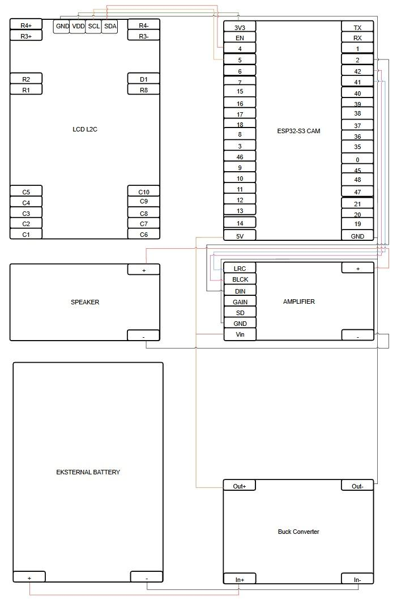
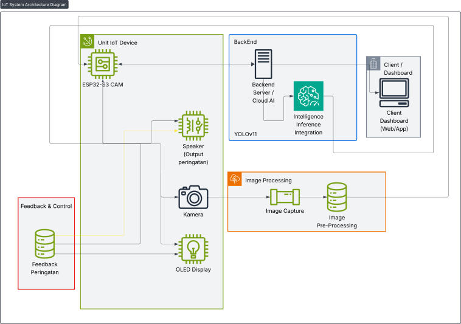
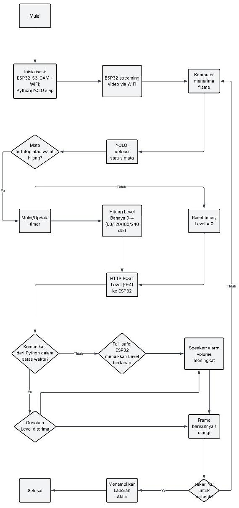

# Dokumentasi Proyek — DOZENT: Sistem Eye-Tracking Deteksi Microsleep (IoT & Sistem Tertanam)

**Mata Kuliah:** Rancangan dan Aplikasi IoT & Sistem Tertanam  
**Nama Proyek:** DOZENT — Sistem Eye-Tracking Berbasis IoT untuk Deteksi Microsleep  
**Kelompok:** 4  
**Anggota:**
1. Fabian Tri Cahyo (24/545040/SV/25590)
2. Muhammad Imam Abraar (24/535422/SV/24225)
3. Nisrina Putri Fatimah Azzahra (24/536085/SV/24378)
4. Revaldi Rifwianda (24/534074/SV/23973)
5. **Shifan Windraya Prassasti** (24/541727/SV/24944)

**Program Studi:** D-IV Teknologi Rekayasa Internet — Sekolah Vokasi UGM, 2025  

---

## 1. Latar Belakang

**Microsleep** adalah episode tidur singkat (0,5–15 detik) yang sering terjadi tanpa disadari, sangat berbahaya saat beraktivitas yang memerlukan konsentrasi tinggi seperti belajar, bekerja, atau menggunakan perangkat komputer. Kondisi ini ditandai dengan perubahan gelombang otak dari *alpha* (8–13 Hz) ke *theta* (4–7 Hz), disertai mata menutup sesaat atau kepala mengangguk.

Kelompok rentan microsleep meliputi: pekerja sif, mahasiswa yang sering begadang, dan profesional yang bekerja di lingkungan monoton.

---

## 2. Permasalahan

1. Tingginya kejadian microsleep saat aktivitas intensif di depan perangkat komputasi.
2. Belum adanya sistem deteksi microsleep real-time khusus untuk pengguna yang duduk di depan laptop/PC.
3. Minimnya mekanisme alarm bertahap yang mendorong pembentukan disiplin dan kesadaran diri pengguna.

---

## 3. Tujuan Proyek

- Membangun sistem IoT yang dapat **mendeteksi microsleep secara real-time** melalui eye-tracking.
- Memberikan **alarm dan konsekuensi bertahap** untuk meningkatkan kesadaran pengguna.
- Merekam data microsleep untuk laporan pemantauan (*after-report*).

---

## 4. Teknologi & Komponen

### Hardware
| Komponen | Fungsi |
|----------|--------|
| ESP32-S3-CAM | Kamera untuk eye-tracking, pemrosesan awal |
| PC/Laptop | Pemrosesan lanjutan, deteksi EAR, dashboard |
| Database IoT | Penyimpanan data kejadian microsleep |

### Pinout & Konektor ESP32-S3-CAM


*Gambar 1: Peta Penggunaan Pin dan Konektor Mikrokontroler ESP32-S3-CAM*

### Software / Logika Sistem
- Program di **ESP32-S3-CAM**: capture gambar mata, kirim ke PC via jaringan.
- Program di **PC**: analisis gambar, deteksi *Eye Aspect Ratio (EAR)*, trigger alarm.

---

## 5. Penyelesaian / Rancangan Sistem

### Alur Sistem DOZENT


*Gambar 2: Diagram Rancangan Arsitektur Sistem DOZENT*


*Gambar 3: Flowchart Logika Deteksi Microsleep dan Level Alarm*

```
Kamera ESP32-S3-CAM
        │
        ▼
Deteksi Facial Landmarks (PC)
        │
        ▼
Hitung Eye Aspect Ratio (EAR)
        │
   EAR < threshold?
        │
       YES ──► Trigger Alarm Bertahap
        │               │
        │       Level 1: Bunyi ringan
        │       Level 2: Bunyi lebih keras
        │       Level 3: Konsekuensi (layar gelap, dll.)
        │
        ▼
   Log ke Database → After Report
```

### Penentuan Microsleep
- Menggunakan metode **Eye Aspect Ratio (EAR)** berdasarkan *facial landmarks detection*.
- EAR di bawah threshold selama durasi tertentu → terdeteksi microsleep.
- Referensi: teknik dari Perdana (2019) dan metode CNN-based drowsiness detection.

### Sistem Alarm Bertahap
- **Level 1:** Alarm ringan (peringatan awal).
- **Level 2:** Alarm lebih keras (peringatan kedua).
- **Level 3:** Konsekuensi bertahap (layar gelap/tindakan lanjutan) untuk membangun disiplin.

---

## 6. Hasil Pengujian

### Perangkat DOZENT
- Hardware berhasil dirakit: ESP32-S3-CAM terpasang dan terhubung ke sistem PC.

### Hasil Pengujian Alat
| Kondisi | Deteksi |
|---------|---------|
| Semua mata terbuka | ✅ Tidak ada trigger alarm |
| Mata tertutup sesaat | ✅ Trigger awal level alarm aktif |
| Mata tertutup berkelanjutan | ✅ Eskalasi ke level berikutnya |

### Halaman After Report
- Sistem berhasil merekam dan menampilkan laporan kejadian microsleep.
- Data tersimpan di database IoT dan dapat diakses melalui halaman *after report*.

---

## 7. Kesimpulan

Sistem DOZENT berhasil dibangun sebagai solusi IoT untuk deteksi microsleep berbasis eye-tracking menggunakan ESP32-S3-CAM dan pemrosesan di PC. Sistem alarm bertahap terbukti efektif memberikan respons proporsional sesuai tingkat keparahan kantuk pengguna. Sistem ini berpotensi meningkatkan produktivitas dan keselamatan pengguna yang bekerja atau belajar dalam waktu lama.
