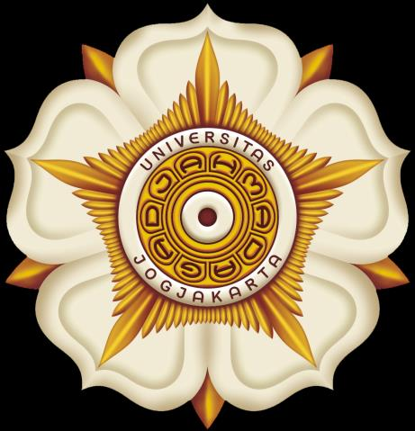
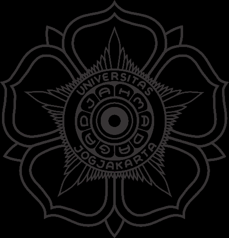

# Dokumentasi Praktikum — Teknik Komputer Dasar (TKD)

**Mata Kuliah:** Teknik Komputer Dasar (TKD)  
**Penyusun:** Shifan Windraya Prassasti (24/541727/SV/24944) — Kelas B2  
**Dosen Pengampu:** Ardhi Wicaksono Santoso, S.Kom., M.Cs.  
**Program Studi:** D-IV Teknologi Rekayasa Internet — Sekolah Vokasi UGM, 2024  

---

## Ringkasan Per Unit

---

*Gambar: Identifikasi Komponen Hardware PC*

### Unit 1 — Pengenalan Komputer

**Tujuan:**
- Mahasiswa memahami komponen dasar komputer (hardware & software).
- Mahasiswa memahami fungsi sistem operasi.

**Penyelesaian:**
Praktikum membahas pengenalan komponen perangkat keras komputer (CPU, RAM, storage, I/O) dan perangkat lunak. Dipelajari juga konsep dasar sistem operasi sebagai pengelola sumber daya.

**Hasil:**
Mahasiswa mampu mengidentifikasi komponen komputer dan memahami peran sistem operasi seperti Windows, macOS, dan Linux dalam mengelola perangkat keras dan menjalankan aplikasi.

---

### Unit 2 — Sistem Operasi

**Tujuan:**
- Mahasiswa memahami konsep dan fungsi sistem operasi.
- Mahasiswa mampu membandingkan berbagai jenis sistem operasi.

**Penyelesaian:**
Dipelajari pengertian sistem operasi sebagai perangkat lunak yang mengelola perangkat keras dan menyediakan layanan untuk aplikasi. Fungsi utama: manajemen CPU, memori, perangkat I/O, dan file. Dibahas perbandingan Windows, macOS, Linux, dan Android.

**Hasil:**
Mahasiswa memahami peran vital sistem operasi dan mampu membedakan karakteristik dari berbagai OS yang umum digunakan.

---

### Unit 3 — Instalasi Sistem Operasi (Windows)

**Tujuan:**
- Mahasiswa mampu melakukan instalasi sistem operasi Windows.
- Mahasiswa memahami tahapan instalasi OS.

**Penyelesaian:**
Praktik langsung instalasi sistem operasi Windows melalui media bootable (USB/ISO). Mencakup partisi disk, pengaturan awal, dan konfigurasi pasca-instalasi.

**Hasil:**
Mahasiswa berhasil melakukan instalasi Windows dari awal hingga sistem siap digunakan.

---

### Unit 4 — Instalasi Ubuntu dan Perintah CLI Dasar

**Tujuan:**
1. Mahasiswa mampu melakukan instalasi Ubuntu melalui VirtualBox.
2. Mahasiswa memahami dan mempraktikkan perintah CLI dasar di Linux.

**Penyelesaian:**
Instalasi Ubuntu dilakukan dalam lingkungan virtual menggunakan VirtualBox. Setelah instalasi, dipraktikkan perintah-perintah CLI Linux dasar seperti `ls`, `cd`, `mkdir`, `cp`, `mv`, `rm`, `cat`, dan `chmod`. Linux dipelajari sebagai OS open-source berbasis Unix.

**Hasil:**
Mahasiswa berhasil menginstal Ubuntu di VirtualBox dan mampu menggunakan perintah-perintah dasar CLI Linux untuk navigasi dan manajemen file system.

---

### Unit 5 — Instalasi Aplikasi

**Tujuan:**
1. Mahasiswa mampu melakukan instalasi program atau aplikasi.
2. Mahasiswa memahami fungsi aplikasi yang diinstal.
3. Mahasiswa mampu menghapus program atau aplikasi.

**Penyelesaian:**
Praktikum instalasi tiga aplikasi utama:
- **LibreOffice** — perangkat perkantoran open-source pengganti Microsoft Office, dikembangkan oleh The Document Foundation (TDF). Mendukung format dokumen Microsoft Office.
- **Aplikasi 2** — (sesuai modul praktikum)
- **Aplikasi 3** — (sesuai modul praktikum)

Selain instalasi, dipraktikkan juga prosedur uninstal aplikasi dengan benar.

**Hasil:**
Mahasiswa berhasil menginstal dan menguninstal berbagai aplikasi, serta memahami fungsi dan perbedaan antara software open-source dan proprietary.

---

### Unit 6 — Microsoft Word

**Tujuan:**
1. Mahasiswa mampu mengatur ukuran/margin halaman, paragraf, dan page break.
2. Mahasiswa mampu menggunakan header, footer, dan penomoran halaman.
3. Mahasiswa mampu membuat daftar isi dan daftar gambar secara otomatis.
4. Mahasiswa mampu menggunakan fitur Citation & Bibliography.

**Penyelesaian:**
Eksplorasi fitur lanjutan Microsoft Word meliputi: pengaturan layout halaman, pembuatan dokumen ilmiah berformat dengan header/footer, pembangkitan daftar isi otomatis menggunakan Heading Styles, dan manajemen referensi ilmiah melalui Citation & Bibliography. Dibahas juga perbedaan fitur Word 2013, 2016, dan 2019 (integrasi OneDrive, Co-authoring, dll.).

**Hasil:**
Mahasiswa mampu membuat dokumen profesional dan ilmiah menggunakan Microsoft Word dengan fitur-fitur lanjutan seperti daftar isi otomatis dan manajemen sitasi.

---

### Unit 7 — Backup and Restore

**Tujuan:**
1. Mahasiswa memahami tujuan backup dan restore.
2. Mahasiswa mampu melakukan backup dan restore sistem Windows 10.

**Penyelesaian:**
Dipelajari konsep backup sebagai pembuatan salinan data untuk perlindungan dari kehilangan atau kerusakan. Data yang perlu dibackup: file pribadi, aplikasi penting, konfigurasi sistem, driver, dan akun. Dipraktikkan backup menggunakan fitur bawaan Windows 10 (System Image, File History) dan restore data dari backup.

**Hasil:**
Mahasiswa berhasil melakukan backup sistem Windows 10 dan memverifikasi proses restore. Mahasiswa memahami pentingnya backup rutin untuk keamanan data.

---

*Gambar: Pengkabelan UTP Straight-through / Crossover*

### Unit 8 — Microsoft Excel

**Tujuan:**
1. Mahasiswa mampu mendemonstrasikan penggunaan rumus dan fungsi bersyarat.
2. Mahasiswa mampu membuat grafik dari data.
3. Mahasiswa mampu membuat tabel dan menggunakan fitur filter.

**Penyelesaian:**
Praktikum menggunakan Microsoft Excel untuk:
1. **Menghitung Stok Akhir** — menggunakan rumus aritmatika dan referensi sel.
2. **Membuat Grafik** — visualisasi data numerik dalam bentuk grafik batang/garis.
3. **Menghitung Rata-rata** — menggunakan fungsi `AVERAGE()` dan fungsi bersyarat `IF()`, `SUMIF()`, `COUNTIF()`.

**Hasil:**
Mahasiswa berhasil mengolah data numerik menggunakan Excel, membuat grafik yang informatif, dan menerapkan fungsi bersyarat untuk analisis data.

---

### Unit 10 — Hard Disk Cloning

**Tujuan:**
1. Mahasiswa memahami tujuan hard disk cloning.
2. Mahasiswa mampu melakukan hard disk cloning menggunakan Clonezilla.

**Penyelesaian:**
Dipelajari konsep kloning hard disk sebagai proses memindahkan seluruh isi hard disk ke hard disk lain. **Clonezilla** digunakan sebagai tools kloning — software bebas open-source dari National Center for High-Performance Computing (NCHC) Taiwan. Proses kloning memungkinkan migrasi sistem tanpa perlu reinstalasi OS dan aplikasi dari awal. Sangat berguna untuk manajemen banyak komputer sekaligus.

**Hasil:**
Mahasiswa berhasil memahami dan mempraktikkan proses kloning hard disk menggunakan Clonezilla, serta memahami keunggulannya dibanding instalasi ulang konvensional.

---

## Ringkasan Topik TKD

| Unit | Topik | Tools/Teknologi |
|------|-------|----------------|
| 1 | Pengenalan Komputer | Hardware, OS Overview |
| 2 | Sistem Operasi | Windows, Linux, macOS |
| 3 | Instalasi Windows | Bootable USB, ISO |
| 4 | Ubuntu & CLI Linux | VirtualBox, Bash CLI |
| 5 | Instalasi Aplikasi | LibreOffice, Software Management |
| 6 | Microsoft Word | MS Word (Heading, TOC, Citation) |
| 7 | Backup & Restore | Windows Backup, File History |
| 8 | Microsoft Excel | Rumus, Grafik, Filter |
| 10 | Hard Disk Cloning | Clonezilla |
