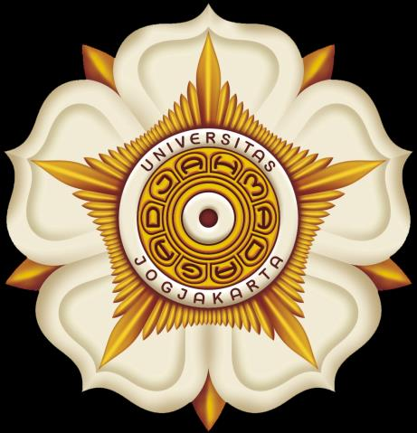

# Dokumentasi Praktikum — Pemrograman Berorientasi Objek (PBO)

**Mata Kuliah:** Pemrograman Berorientasi Objek (PBO)  
**Penyusun:** Shifan Windraya Prassasti (24/541727/SV/24944) — Kelas B2  
**Dosen Pengampu:** Dr. Sahirul Alam, S.T., M.Eng.  
**Program Studi:** D-IV Teknologi Rekayasa Internet — Sekolah Vokasi UGM, 2025  

> **Bahasa Pemrograman:** Python 3

---

## Ringkasan Per Latihan

---

*Gambar: Implementasi Class dan Objek Python OOP*

### Latihan 1 — Kelas dan Objek

**Tujuan:**
Memahami konsep dasar OOP: kelas (class) sebagai blueprint dan objek (object) sebagai instance dari kelas.

**Penyelesaian:**
- **Kelas** adalah cetakan/template yang mendefinisikan atribut dan method.
- **Objek** adalah entitas nyata yang dibuat dari kelas, memiliki nilai atribut sendiri.
- Dipraktikkan pembuatan kelas `Warga` dengan atribut `Nama` dan `NIK`, konstruktor `__init__`, dan method untuk menampilkan data.
- Pembuatan objek: `warga1 = Warga(nama="...", nik="...")`.

**Hasil:**
Mahasiswa berhasil membuat kelas dan objek sederhana di Python dan memahami konsep encapsulation dasar melalui konstruktor.

---

### Latihan 2 — Inheritance (Pewarisan)

**Tujuan:**
Memahami konsep inheritance dalam OOP — kemampuan kelas anak mewarisi properti dan method dari kelas induk.

**Penyelesaian:**
- **Inheritance** memungkinkan pembuatan kelas baru (subclass/child class) yang mewarisi semua properti dan method dari kelas yang sudah ada (superclass/parent class).
- Subclass dapat menambah atribut/method baru atau memodifikasi yang diwarisi (override).
- Dipraktikkan hierarki kelas dengan keyword `class Child(Parent):`.

**Hasil:**
Mahasiswa memahami dan mengimplementasikan inheritance single dan bertingkat, serta memahami konsep `super()` untuk memanggil konstruktor kelas induk.

---

### Latihan 3 — Inheritance Part 2

**Tujuan:**
Memperdalam pemahaman inheritance dengan kasus yang lebih kompleks dan multiple attribute.

**Penyelesaian:**
- Dibuat kelas `Orang` dengan 3 atribut: `nama_depan`, `nama_belakang`, `nomer_id`.
- Dipraktikkan pembuatan objek `orang1 = Orang("Susan", "Prasetya", 3404)` dan akses atributnya.
- Dilanjutkan dengan pembuatan subclass yang mewarisi dan memperluas kelas `Orang`.

**Hasil:**
Mahasiswa mampu merancang hierarki kelas yang lebih kompleks dan menggunakan inheritance untuk efisiensi kode (code reusability).

---

### Latihan 4 — Abstract Base Class (ABC)

**Tujuan:**
Memahami konsep Abstract Base Class sebagai blueprint kelas abstrak yang tidak dapat diinstansiasi langsung.

**Penyelesaian:**
- Menggunakan modul `abc` dari Python (`from abc import ABC, abstractmethod`).
- Kelas abstrak mendefinisikan method abstrak yang **wajib** diimplementasikan oleh subclass-nya.
- Memastikan semua kelas turunan memiliki implementasi method yang konsisten.

**Hasil:**
Mahasiswa memahami penggunaan ABC untuk memaksa standar implementasi di semua subclass, serta memahami perbedaan antara kelas abstrak dan kelas konkret.

---

### Latihan 5 — Polymorphism

**Tujuan:**
Memahami polimorfisme — kemampuan objek berbeda merespons perintah yang sama dengan cara berbeda.

**Penyelesaian:**
- Dibuat program yang menampilkan informasi ibukota provinsi di Indonesia menggunakan polimorfisme.
- Setiap kelas provinsi (misal `Serang`, dll.) memiliki method `capital()` yang menghasilkan output berbeda.
- Fungsi `capital_province()` memanggil method `capital()` pada berbagai objek → output berbeda tergantung kelas.

**Hasil:**
Mahasiswa memahami dan mengimplementasikan polimorfisme melalui method overriding, sehingga satu interface dapat memiliki banyak bentuk implementasi.

---

### Latihan 6 — Class Attribute dan Decorator

**Tujuan:**
Memahami perbedaan class attribute vs instance attribute, dan penerapan decorator `@property`.

**Penyelesaian:**
- **Class attribute** dimiliki bersama oleh semua objek dari kelas tersebut.
- **Instance attribute** dimiliki oleh masing-masing objek secara individual.
- Analisis error: `print(Passenger.title)` menyebabkan error karena `title` adalah instance attribute (harus diakses melalui objek: `print(p1.title)`).
- Dipelajari penggunaan `@property` decorator untuk getter/setter yang lebih bersih.

**Hasil:**
Mahasiswa memahami scope attribute dalam OOP Python dan cara menggunakan property decorator untuk encapsulation yang lebih baik.

---

### Latihan 7 — Class Decorator

**Tujuan:**
Memperdalam pemahaman dan penggunaan decorator pada kelas Python.

**Penyelesaian:**
- Decorator adalah fungsi yang memodifikasi perilaku fungsi/method lain.
- Dipelajari `@staticmethod`, `@classmethod`, dan custom decorator.
- Praktik menjalankan program dengan decorator dan menganalisis alur eksekusinya.

**Hasil:**
Mahasiswa mampu menggunakan decorator bawaan Python (`@property`, `@staticmethod`, `@classmethod`) dan memahami cara kerja decorator pattern dalam OOP.

---

### Latihan 8 — Named Tuple

**Tujuan:**
Memahami penggunaan `namedtuple` dari modul `collections` sebagai struktur data yang efisien dan mudah dibaca.

**Penyelesaian:**
- `namedtuple` adalah subclass dari tuple dengan field yang dapat diakses melalui nama.
- Dibuat `namedtuple` bernama `Koordinat` dengan field `x` dan `y`.
- Instance dibuat: `titik1 = Koordinat(x=2, y=4)`.
- Tiga cara akses elemen: 
  1. Indeks: `titik1[0]`
  2. Field name: `titik1.x`
  3. `getattr()`: `getattr(titik1, 'x')`

**Hasil:**
Mahasiswa memahami keunggulan `namedtuple` dibanding tuple biasa (lebih readable) dan dict (lebih efisien memori, immutable).

---

*Gambar: Implementasi Graphical User Interface (GUI) Tkinter*

### Latihan 10 — MVC Pattern

**Tujuan:**
Memahami dan mengimplementasikan pola arsitektur Model-View-Controller (MVC) dalam Python.

**Penyelesaian:**
- **Model:** Menyimpan data *services* (email, SMS, voice) dengan atribut `number` (1000) dan `price` per layanan.
- **View:** Menampilkan data ke pengguna.
- **Controller:** Menghubungkan Model dan View, menangani logika bisnis.
- Contoh program: sistem informasi layanan telekomunikasi berbasis MVC.

**Hasil:**
Mahasiswa berhasil mengimplementasikan pola MVC — memisahkan data (Model), tampilan (View), dan logika (Controller) — yang merupakan fondasi pengembangan aplikasi modern yang terstruktur dan mudah di-maintain.

---

## Ringkasan Topik PBO

| Latihan | Topik | Konsep OOP |
|---------|-------|-----------|
| 1 | Kelas dan Objek | Class, Object, Constructor |
| 2 | Inheritance | Single Inheritance, `super()` |
| 3 | Inheritance Part 2 | Multi-attribute, Hierarki Kelas |
| 4 | Abstract Base Class | ABC, Abstract Method |
| 5 | Polymorphism | Method Overriding |
| 6 | Class Attribute & Decorator | `@property`, Instance vs Class Attr |
| 7 | Class Decorator | `@staticmethod`, `@classmethod` |
| 8 | Named Tuple | `collections.namedtuple` |
| 10 | MVC Pattern | Model-View-Controller Architecture |

> **Proyek Akhir:** Mood Detector — Aplikasi GUI Python/tkinter menggunakan pola MVC untuk mendeteksi dan merekam kondisi mood pengguna. (Lihat dokumentasi terpisah: `01_Proyek_PBO_Mood_Detector.md`)
