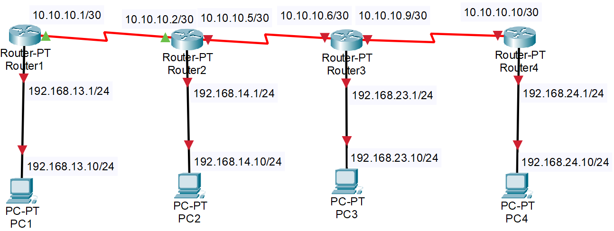
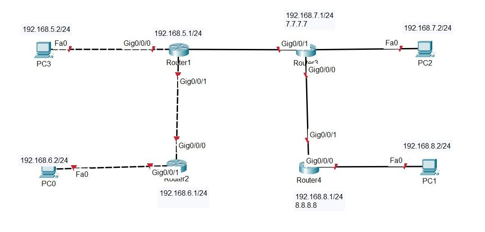

# Dokumentasi Praktikum — Jaringan Komputer 2 (PJK2)

**Mata Kuliah:** Jaringan Komputer 2  
**Penyusun:** Shifan Windraya Prassasti (24/541727/SV/24944) — Kelas B2  
**Dosen Pengampu:** Ardhi Wicaksono Santoso, S.Kom., M.Cs.  
**Asisten:** Alvin Oktavian Surya Saputra, Muhammad Taqiyuddin Alfatih  
**Program Studi:** D-IV Teknologi Rekayasa Internet — Sekolah Vokasi UGM, 2025  

> **Platform Utama:** Router MikroTik — dikonfigurasi via **WinBox**

---

## Ringkasan Per Pertemuan

---

### Pertemuan 1 — Menghubungkan Router ke Internet

**Tujuan:**
1. Mengoneksikan Router dengan Internet via UTP.
2. Mengoneksikan Router dengan Internet via Wireless.
3. Menetapkan IP Address Statis atau Dinamis.

**Penyelesaian:**
- Koneksi router ke internet melalui dua metode: kabel UTP (ether1 ke ISP) dan wireless.
- Konfigurasi IP address statis pada interface, default route, NAT masquerade.
- Konfigurasi IP dinamis (DHCP client) pada interface yang terhubung ke ISP.

**Hasil:**
Router berhasil terhubung ke internet melalui kedua metode (UTP dan wireless). IP statis dan dinamis berhasil dikonfigurasi dan diuji konektivitasnya.

---

### Pertemuan 2 — Kualitas Link Wireless (AP-Station)

**Tujuan:**
1. Praktikan dapat mengetahui kualitas link antara AP dengan Station.
2. Praktikan dapat melakukan konfigurasi antar perangkat wireless dengan MikroTik.

**Penyelesaian:**
Pengukuran kualitas link wireless antara router yang berperan sebagai Access Point (AP) dan Station. Konfigurasi dilakukan melalui WinBox versi 6.49.17 pada RouterOS hAP ac. Analisis parameter link seperti signal strength dan CCQ.

**Perangkat:** PC/Laptop 1 unit, Router MikroTik RB962UiGS-5HacT2HnT, OS Windows 11/Ubuntu.

**Hasil:**
Kualitas link wireless berhasil diukur dan dianalisis. Mahasiswa memahami faktor-faktor yang mempengaruhi kualitas link wireless (jarak, interferensi, sinyal).

---

*Gambar: Konfigurasi Virtual LAN (VLAN) dan Trunking*

### Pertemuan 3 — Konfigurasi Jaringan Rumah (Home Network)

**Tujuan:**
- Mengonfigurasi alamat IP.
- Menyiapkan konfigurasi nirkabel di jaringan rumah.
- Memverifikasi konektivitas.

**Penyelesaian:**
Simulasi konfigurasi jaringan rumah sederhana menggunakan MikroTik sebagai router/AP rumahan. Konfigurasi IP address lokal, pengaturan SSID wireless, dan verifikasi konektivitas antar perangkat.

**Hasil:**
Jaringan rumah sederhana berhasil dikonfigurasi dengan router MikroTik. Konektivitas antar perangkat berhasil diverifikasi.

---

### Pertemuan 4 — Access List, Connect List & Virtual AP

**Tujuan:**
1. Memahami pengertian Access List, Connect List, dan Virtual Access Point.
2. Melakukan konfigurasi antar perangkat wireless dengan Virtual Access Point.

**Penyelesaian:**
- **Access List:** Daftar kontrol akses perangkat yang boleh terhubung ke AP.
- **Connect List:** Prioritas koneksi dari sisi Station ke AP tertentu.
- **Virtual AP:** Membuat beberapa SSID virtual dari satu interface wireless fisik untuk segmentasi pengguna.

**Hasil:**
Virtual Access Point berhasil dibuat — satu router memancarkan beberapa SSID dengan pengaturan akses berbeda. Access List dan Connect List berhasil dikonfigurasi.

---

### Pertemuan 5 — Security Wireless (Hide SSID, WEP, WPA/WPA2)

**Tujuan:**
1. Mengetahui berbagai cara pengamanan jaringan wireless.
2. Mengkonfigurasi keamanan jaringan wireless pada MikroTik.

**Penyelesaian:**
Konfigurasi berbagai metode keamanan wireless:
- **Hide SSID:** Menyembunyikan nama jaringan agar tidak terdeteksi secara mudah.
- **WEP:** Enkripsi dasar (sudah usang, rentan).
- **WPA/WPA2:** Standar enkripsi modern.
  - **TKIP** vs **AES** — AES (WPA2) adalah standar yang lebih aman.
  - WPA2 dengan AES adalah konfigurasi keamanan yang direkomendasikan.

**Hasil:**
Mahasiswa berhasil mengonfigurasi berbagai level keamanan wireless dan memahami perbedaan keamanan serta kompatibilitas antara WEP, WPA, dan WPA2.

---

### Pertemuan 6 — Security 2 (Advanced Wireless Security)

**Tujuan:**
Memperdalam implementasi keamanan jaringan wireless tingkat lanjut pada MikroTik.

**Penyelesaian:**
Konfigurasi keamanan wireless lanjutan meliputi autentikasi tambahan, enkripsi yang lebih kuat, dan mekanisme proteksi jaringan dari akses tidak sah.

**Hasil:**
Implementasi keamanan wireless tingkat lanjut berhasil dikonfigurasi dan diuji.

---

### Pertemuan 7 — Wireless Distribution System (WDS)

**Tujuan:**
Memahami dan mengonfigurasi Wireless Distribution System (WDS) untuk memperluas jangkauan jaringan wireless.

**Penyelesaian:**
WDS memungkinkan beberapa Access Point saling terhubung secara wireless untuk memperluas jangkauan jaringan tanpa kabel backbone. Konfigurasi WDS mode pada MikroTik untuk membentuk jaringan mesh wireless.

**Hasil:**
WDS berhasil dikonfigurasi — beberapa AP saling terhubung dan memperluas jangkauan jaringan wireless secara seamless.

---

### Pertemuan 8 — WDS Mesh dan Nstreme

**Tujuan:**
Memahami WDS Mesh dan protokol Nstreme untuk optimasi jaringan wireless point-to-point.

**Penyelesaian:**
- **WDS Mesh:** Topologi mesh wireless di mana setiap node dapat berkomunikasi dengan node lain secara dinamis.
- **Nstreme:** Protokol MikroTik proprietary untuk meningkatkan throughput dan efisiensi pada link wireless point-to-point.

**Hasil:**
WDS Mesh dan Nstreme berhasil dikonfigurasi. Performa jaringan wireless meningkat dengan penggunaan Nstreme dibanding standar 802.11.

---

### Pertemuan 9 — Hotspot

**Tujuan:**
Memahami dan mengonfigurasi Hotspot pada MikroTik untuk manajemen akses pengguna wireless.

**Penyelesaian:**
Konfigurasi Hotspot MikroTik melalui `IP > Hotspot`: pembuatan user database, konfigurasi halaman login portal, pengaturan bandwidth per user, dan session management.

**Hasil:**
Hotspot berhasil dikonfigurasi dengan portal login. Manajemen pengguna (tambah/hapus user, batas waktu, kuota) berhasil diimplementasikan.

---

### Pertemuan 10 — Hotspot 2 (Lanjutan)

**Tujuan:**
Memperdalam konfigurasi Hotspot MikroTik dengan fitur-fitur lanjutan.

**Penyelesaian:**
Konfigurasi lanjutan Hotspot: kustomisasi halaman portal login, profile manajemen (bandwidth profile berbeda per tier pengguna), dan integrasi dengan RADIUS server untuk autentikasi terpusat.

**Hasil:**
Sistem Hotspot dengan manajemen pengguna bertingkat berhasil dikonfigurasi — berbagai profil pengguna mendapatkan bandwidth yang berbeda sesuai kategori.

---

*Gambar: Pengujian Enkripsi dan Konektivitas VPN Tunnel*

### Pertemuan 11 — Wireless Bonding

**Tujuan:**
Memahami dan mengonfigurasi Wireless Bonding untuk meningkatkan throughput/redundansi jaringan wireless.

**Penyelesaian:**
Bonding menggabungkan dua atau lebih interface wireless menjadi satu interface virtual untuk meningkatkan bandwidth total atau menyediakan redundansi link. Konfigurasi bonding mode (LACP/balance-rr) pada MikroTik.

**Hasil:**
Wireless Bonding berhasil dikonfigurasi. Throughput jaringan meningkat dengan penggabungan dua interface wireless.

---

### Pertemuan 12 — Quality of Service (QoS)

**Tujuan:**
Memahami dan mengonfigurasi Quality of Service (QoS) pada jaringan wireless MikroTik.

**Penyelesaian:**
QoS diimplementasikan untuk memberikan prioritas trafik tertentu (misal: video call lebih diprioritaskan dari download file). Konfigurasi Queue Tree, PCQ (Per-Connection Queue), dan marking trafik menggunakan Mangle.

**Hasil:**
QoS berhasil dikonfigurasi — trafik kritis (VoIP, video) mendapat prioritas bandwidth lebih tinggi, menghasilkan pengalaman pengguna yang lebih baik pada jaringan padat.

---

### Pertemuan 13 — Quality of Service 2 (QoS Lanjutan)

**Tujuan:**
Memperdalam implementasi QoS dengan kasus dan skenario yang lebih kompleks.

**Penyelesaian:**
Implementasi QoS lanjutan dengan multiple queue tree dan prioritas bertingkat. Marking trafik berdasarkan protokol, port, atau IP address tujuan untuk manajemen bandwidth yang lebih granular.

**Hasil:**
QoS multi-level berhasil dikonfigurasi dengan prioritas yang dapat disesuaikan per jenis trafik.

---

### Pertemuan 14 — CAPsMAN (Centralized AP Management)

**Tujuan:**
Memahami dan mengonfigurasi CAPsMAN untuk manajemen terpusat beberapa Access Point MikroTik.

**Penyelesaian:**
**CAPsMAN (Controlled Access Point Manager)** memungkinkan satu router pusat mengelola konfigurasi banyak AP secara terpusat. Konfigurasi CAPsMAN controller dan CAP (Controlled Access Point) pada masing-masing router.

**Hasil:**
CAPsMAN berhasil dikonfigurasi — semua AP terdaftar dan dapat dikelola dari satu titik pusat. Perubahan konfigurasi (SSID, keamanan, channel) di controller otomatis diterapkan ke semua AP.

---

## Ringkasan Topik PJK2

| Pertemuan | Topik | Teknologi/Protokol |
|-----------|-------|-------------------|
| 1 | Router ke Internet | UTP, Wireless, IP Static/DHCP |
| 2 | Kualitas Link Wireless | AP-Station, Signal Quality |
| 3 | Home Network | IP Config, Wireless Setup |
| 4 | Virtual AP & Access List | Virtual AP, Connect List |
| 5 | Security Wireless 1 | Hide SSID, WEP, WPA/WPA2, AES |
| 6 | Security Wireless 2 | Advanced Security |
| 7 | WDS | Wireless Distribution System |
| 8 | WDS Mesh & Nstreme | Mesh Topology, Proprietary Protocol |
| 9 | Hotspot | Portal Login, User Management |
| 10 | Hotspot Lanjutan | RADIUS, Bandwidth Profile |
| 11 | Wireless Bonding | Link Aggregation, Redundancy |
| 12 | QoS | Queue Tree, Mangle, PCQ |
| 13 | QoS Lanjutan | Multi-level Priority |
| 14 | CAPsMAN | Centralized AP Management |
