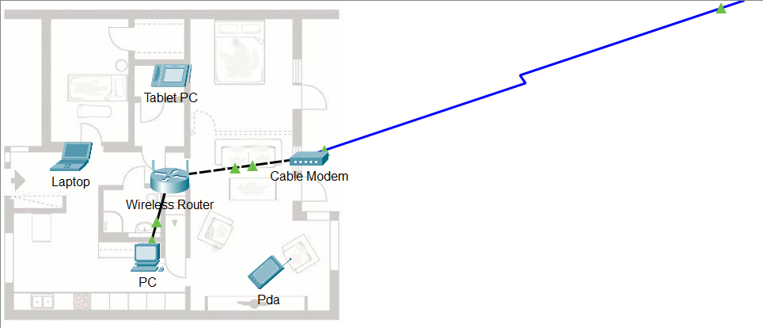
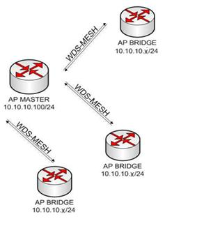

# Dokumentasi Praktikum — Teknologi Nirkabel / PTN (Wireless MikroTik)

**Mata Kuliah:** Teknologi Nirkabel (PTN)  
**Penyusun:** Shifan Windraya Prassasti (24/541727/SV/24944) — Kelas B2  
**Dosen Pengampu:** Alif Subardono, S.T., M.Eng.  
**Asisten:** Isa Maliki, Naazril Suwandana Putu  
**Program Studi:** D-IV Teknologi Rekayasa Internet — Sekolah Vokasi UGM, 2025  

> **Platform Utama:** Router MikroTik RB962UiGS-5HacT2HnT — WinBox 6.49.17 (hAP ac)

---

## Ringkasan Per Pertemuan

---

### Pertemuan 1 — Pengenalan Teknologi Nirkabel

**Tujuan:**
Memahami konsep dasar teknologi nirkabel (wireless) dan pengenalan perangkat MikroTik untuk jaringan wireless.

**Penyelesaian:**
Pengenalan standar wireless IEEE 802.11 (a/b/g/n/ac), karakteristik frekuensi 2.4 GHz vs 5 GHz, komponen jaringan wireless (AP, Station, Client), dan antarmuka WinBox MikroTik untuk konfigurasi wireless.

**Hasil:**
Mahasiswa memahami dasar-dasar teknologi nirkabel dan siap untuk melakukan konfigurasi praktis pada perangkat MikroTik.

---

### Pertemuan 2 — Konfigurasi Dasar Wireless (AP & Station)

**Tujuan:**
1. Praktikan dapat mengetahui kualitas link antara AP dengan Station.
2. Praktikan dapat melakukan konfigurasi antar perangkat wireless dengan MikroTik.

**Penyelesaian:**
- Konfigurasi router sebagai **Access Point (AP)** dan router lain sebagai **Station**.
- Pengukuran kualitas link (signal strength, CCQ, Tx/Rx rate).
- Verifikasi konektivitas antar perangkat.

**Perangkat:** PC/Laptop, Router MikroTik RB962UiGS, WinBox 6.49.17, OS Windows 11/Ubuntu.

**Hasil:**
Koneksi wireless AP-Station berhasil terbentuk. Mahasiswa dapat menganalisis kualitas link wireless dan faktor-faktor yang mempengaruhinya.

---

*Gambar: Implementasi Point-to-Point (PtP) Wireless Bridge*

### Pertemuan 3 — Home Wireless Network

**Tujuan:**
- Mengonfigurasi alamat IP.
- Menyiapkan konfigurasi nirkabel di jaringan rumah.
- Memverifikasi konektivitas.

**Penyelesaian:**
Simulasi pengaturan router wireless untuk keperluan jaringan rumah: konfigurasi IP, pengaturan SSID dan password, dan verifikasi konektivitas perangkat klien.

**Hasil:**
Jaringan rumah wireless berhasil dikonfigurasi dan semua perangkat klien dapat terhubung dengan baik.

---

### Pertemuan 4 — Access List, Connect List & Virtual AP

**Tujuan:**
1. Memahami Access List, Connect List, dan Virtual Access Point.
2. Melakukan konfigurasi wireless dengan Virtual AP.

**Penyelesaian:**
- **Access List:** Membatasi perangkat yang boleh terhubung ke AP berdasarkan MAC address.
- **Connect List:** Mengatur prioritas AP mana yang diutamakan oleh Station saat terhubung.
- **Virtual AP:** Satu interface wireless fisik memacarkan beberapa SSID virtual dengan pengaturan berbeda (misal: SSID tamu vs SSID internal).

**Hasil:**
Virtual AP berhasil dibuat dengan beberapa SSID berbeda dari satu perangkat wireless. Access List berhasil membatasi akses berdasarkan MAC address.

---

### Pertemuan 5 — Security 1 (Hide SSID, WEP, WPA/WPA2)

**Tujuan:**
1. Mengetahui berbagai cara pengamanan jaringan wireless.
2. Mengonfigurasi keamanan wireless pada MikroTik.

**Penyelesaian:**
- **Hide SSID:** SSID disembunyikan dari pemindaian jaringan — klien harus mengetahui SSID secara manual.
- **WEP:** Enkripsi 40/128-bit, sudah rentan, tidak direkomendasikan.
- **WPA (TKIP):** Lebih aman dari WEP, menggunakan enkripsi per-packet.
- **WPA2 (AES):** Standar keamanan terkuat — AES (Advanced Encryption Standard) jauh lebih aman dari TKIP.

| Metode | Keamanan | Status |
|--------|----------|--------|
| Open | ❌ Tidak ada | Tidak disarankan |
| Hide SSID | ⚠️ Sangat lemah | Hanya untuk obscurity |
| WEP | ⚠️ Lemah | Deprecated |
| WPA-TKIP | ✅ Cukup | Gunakan jika WPA2 tidak tersedia |
| WPA2-AES | ✅✅ Terbaik | **Direkomendasikan** |

**Hasil:**
Semua metode keamanan berhasil dikonfigurasi. Mahasiswa memahami kelebihan dan kekurangan tiap metode dan merekomendasikan WPA2-AES sebagai standar.

---

### Pertemuan 6 — Security 2 (Advanced Wireless Security)

**Tujuan:**
Memperdalam implementasi keamanan wireless tingkat lanjut.

**Penyelesaian:**
Konfigurasi keamanan lanjutan: MAC address filtering, blacklist/whitelist perangkat, dan konfigurasi enkripsi yang lebih ketat. Simulasi skenario serangan dan pencegahannya.

**Hasil:**
Keamanan wireless berlapis berhasil dikonfigurasi — kombinasi autentikasi, enkripsi, dan filtering memberikan perlindungan menyeluruh.

---

### Pertemuan 7 — Wireless Distribution System (WDS)

**Tujuan:**
Memahami dan mengonfigurasi WDS untuk memperluas coverage area wireless.

**Penyelesaian:**
WDS menghubungkan beberapa AP secara wireless (tanpa kabel backbone) untuk memperluas jangkauan. Konfigurasi WDS pada MikroTik: aktifkan WDS di interface wireless, tambah WDS peer dengan MAC address AP yang dituju.

**Hasil:**
Jaringan WDS berhasil dibentuk — coverage area wireless meluas tanpa memerlukan kabel tambahan antara AP.

---

*Gambar: Manajemen Access Point Terpusat dengan CAPsMAN*

### Pertemuan 8 — WDS Mesh dan Nstreme

**Tujuan:**
Memahami WDS Mesh dan protokol Nstreme untuk performa wireless yang lebih baik.

**Penyelesaian:**
- **WDS Mesh:** Topologi di mana setiap node dapat menjadi AP sekaligus repeater, memungkinkan rute dinamis dan self-healing.
- **Nstreme:** Protokol proprietary MikroTik untuk meningkatkan efisiensi pada link point-to-point (PtP). Menggantikan CSMA/CA dengan polling mechanism sehingga throughput lebih tinggi dan latency lebih rendah.

**Hasil:**
WDS Mesh dengan Nstreme berhasil dikonfigurasi — throughput lebih tinggi dan latency lebih rendah dibanding konfigurasi standar 802.11.

---

### Pertemuan 9 — Hotspot

**Tujuan:**
Memahami dan mengonfigurasi Hotspot pada MikroTik.

**Penyelesaian:**
Konfigurasi lengkap Hotspot MikroTik (`IP > Hotspot`):
1. Pembuatan server Hotspot pada interface wireless.
2. Konfigurasi IP pool untuk klien Hotspot.
3. Pembuatan user accounts (username & password).
4. Kustomisasi halaman login portal.

**Hasil:**
Hotspot berfungsi penuh — pengguna diarahkan ke halaman login portal sebelum dapat mengakses internet. User management berjalan dengan baik.

---

### Pertemuan 10 — Hotspot 2 (User Profile & Bandwidth)

**Tujuan:**
Konfigurasi Hotspot lanjutan dengan manajemen profil dan bandwidth per pengguna.

**Penyelesaian:**
- **User Profile:** Pembuatan berbagai profil pengguna (Basic, Premium) dengan limit bandwidth berbeda.
- **Bandwidth Limitation:** Profil Basic: 1 Mbps up/down; Profil Premium: 10 Mbps up/down.
- **Session Limit:** Batas waktu dan kuota data per session pengguna.

**Hasil:**
Sistem Hotspot multi-tier berhasil dikonfigurasi. Pengguna mendapat bandwidth sesuai profil yang ditetapkan, manajemen kuota dan waktu berjalan otomatis.

---

### Pertemuan 11 — Wireless Bonding

**Tujuan:**
Memahami dan mengonfigurasi Wireless Bonding untuk meningkatkan bandwidth atau redundansi.

**Penyelesaian:**
Bonding menggabungkan dua interface wireless menjadi satu interface logis. Mode bonding:
- **Balance-RR (Round Robin):** Distribusi paket bergantian untuk meningkatkan throughput total.
- **Active-Backup:** Satu interface aktif, satu standby sebagai backup (redundansi).

**Hasil:**
Wireless Bonding berhasil dikonfigurasi. Throughput jaringan meningkat secara signifikan dengan penggabungan dua interface wireless.

---

### Pertemuan 12 — Quality of Service (QoS)

**Tujuan:**
Memahami dan mengonfigurasi QoS pada jaringan wireless MikroTik.

**Penyelesaian:**
- **Queue Tree:** Hierarki queue untuk prioritas trafik.
- **PCQ (Per-Connection Queue):** Membagi bandwidth secara adil antar koneksi.
- **Mangle:** Marking trafik berdasarkan protokol/port untuk prioritisasi.
- Prioritas: VoIP > Video Streaming > Browsing > Download file.

**Hasil:**
QoS berhasil memberi prioritas pada trafik kritis. Pada kondisi jaringan padat, VoIP dan video tetap berjalan lancar karena diprioritaskan.

---

### Pertemuan 13 — Quality of Service 2

**Tujuan:**
Implementasi QoS dengan skenario lebih kompleks dan granular.

**Penyelesaian:**
QoS multi-level dengan Queue Tree bertingkat — setiap departemen/pengguna mendapat alokasi bandwidth terpisah, dengan sub-prioritas berdasarkan jenis trafik di dalam alokasi tersebut.

**Hasil:**
Manajemen bandwidth granular berhasil diimplementasikan — setiap entitas jaringan mendapat alokasi yang adil sesuai kebijakan.

---

### Pertemuan 14 — CAPsMAN (Centralized AP Manager)

**Tujuan:**
Memahami dan mengonfigurasi CAPsMAN untuk manajemen terpusat Access Point.

**Penyelesaian:**
- **CAPsMAN Controller:** Router pusat yang mengatur konfigurasi semua AP.
- **CAP (Controlled AP):** Router-router AP yang dikontrol oleh CAPsMAN.
- Konfigurasi mencakup: channel/frequency, SSID, security profile, dan data forwarding mode.
- Semua AP mendapat konfigurasi identik dari controller secara otomatis.

**Hasil:**
CAPsMAN berhasil mengelola beberapa AP secara terpusat. Perubahan konfigurasi di controller langsung diterapkan ke semua AP — efisiensi manajemen jaringan meningkat drastis dibanding konfigurasi AP manual satu per satu.

---

## Ringkasan Topik PTN

| Pertemuan | Topik | Teknologi/Protokol |
|-----------|-------|-------------------|
| 1 | Pengenalan Wireless | IEEE 802.11, 2.4/5 GHz |
| 2 | AP & Station | Kualitas Link, CCQ |
| 3 | Home Network | IP Config, SSID Setup |
| 4 | Virtual AP & Access List | Virtual Interface, MAC Filter |
| 5 | Security 1 | Hide SSID, WEP, WPA/WPA2-AES |
| 6 | Security 2 | Advanced Security, Blacklist |
| 7 | WDS | Wireless Distribution System |
| 8 | WDS Mesh & Nstreme | Mesh Topology, Proprietary Protocol |
| 9 | Hotspot | Portal Login, User Management |
| 10 | Hotspot Lanjutan | User Profile, Bandwidth Limit |
| 11 | Wireless Bonding | Link Aggregation |
| 12 | QoS 1 | Queue Tree, Mangle, PCQ |
| 13 | QoS 2 | Multi-level Priority |
| 14 | CAPsMAN | Centralized AP Management |
