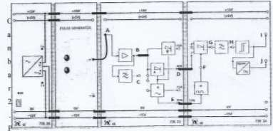
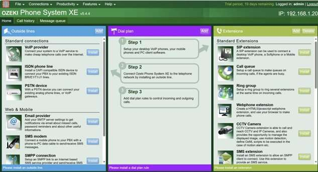

# Dokumentasi Praktikum — Teknik Telekomunikasi

**Mata Kuliah:** Teknik Telekomunikasi  
**Penyusun:** Shifan Windraya Prassasti (24/541727/SV/24944) — Kelas RIB2  
**Dosen Pengampu:** Ir. Budi Bayu Murti, S.T., M.T.  
**Laboran:** Tanto Kiswantoro, S.T.  
**Asisten:** Kareen Atanja Sumaryadi, Aini Intan Cahyani  
**Lab:** Laboratorium Layanan Telekomunikasi — Sekolah Vokasi UGM, 2025  

---

## Ringkasan Per Unit

---

*Gambar: Analisis Gelombang Modulasi Digital ASK/FSK/PSK*

### Unit 2 — Modulasi Digital (ASK, FSK, PSK)

**Tujuan:**
Memahami teknik modulasi digital untuk transmisi data biner melalui kanal komunikasi band-pass.

**Penyelesaian:**
Pada modulasi digital, sinyal pemodulasi berupa sinyal digital (biner). Dipelajari tiga teknik utama:
- **ASK (Amplitude Shift Keying):** Mengubah amplitudo sinyal pembawa sesuai simbol biner (0/1).
- **FSK (Frequency Shift Keying):** Mengubah frekuensi sinyal pembawa untuk tiap simbol biner.
- **PSK (Phase Shift Keying):** Mengubah fase sinyal pembawa, lebih efisien spektrum dibanding ASK/FSK.

Pada modulasi biner, setiap perubahan (switching/keying) berhubungan dengan pertukaran antara dua nilai kemungkinan besaran sesuai simbol "0" dan "1".

**Hasil:**
Mahasiswa memahami prinsip dan perbedaan ketiga teknik modulasi digital dasar beserta karakteristik masing-masing dalam hal efisiensi spektrum dan ketahanan terhadap noise.

---

### Unit 3 — Antena Dipole

**Tujuan:**
Memahami karakteristik dan prinsip kerja antena dipole dalam sistem telekomunikasi.

**Penyelesaian:**
Antena dipole adalah antena paling dasar dan umum digunakan. Terdiri dari dua konduktor sejajar dengan panjang total setengah panjang gelombang (λ/2). Dipelajari:
- Pola radiasi antena dipole (omnidirectional pada bidang horizontal).
- Impedansi input (~73 Ω untuk dipole λ/2).
- Pengaruh panjang antena terhadap frekuensi resonansi.
- Perbandingan antena dipole dengan antena lainnya.

**Hasil:**
Mahasiswa memahami karakteristik antena dipole, cara menghitung panjang antena untuk frekuensi tertentu, dan pola radiasinya dalam sistem komunikasi nirkabel.

---

### Unit 4 — Multiplexer Berdasarkan Frekuensi (FDM)

**Tujuan:**
Memahami teknik Frequency Division Multiplexing (FDM) untuk transmisi multi-channel.

**Penyelesaian:**
**FDM (Frequency Division Multiplexing)** adalah teknik yang membagi bandwidth saluran komunikasi menjadi beberapa sub-band frekuensi, di mana setiap sub-band dialokasikan untuk satu sinyal/pengguna. Dipelajari:
- Prinsip multiplexing dan demultiplexing frekuensi.
- Guard band antara sub-channel untuk menghindari interferensi.
- Aplikasi FDM: radio AM/FM, TV analog, DSL (ADSL menggunakan DMT yang berbasis FDM).
- Simulasi FDM menggunakan software/lab kit.

**Hasil:**
Mahasiswa memahami prinsip FDM dan dapat menghitung alokasi frekuensi untuk sistem multi-channel. Simulasi FDM berhasil menunjukkan pemisahan sinyal berdasarkan frekuensi.

---

### Unit 5 — Model Saluran 2 Kawat

**Tujuan:**
Memahami model saluran transmisi 2 kawat dan karakteristik propagasinya.

**Penyelesaian:**
Saluran 2 kawat (twisted pair / parallel wire) adalah media transmisi fundamental dalam telekomunikasi. Dipelajari:
- **Parameter primer saluran:** Resistansi (R), Induktansi (L), Konduktansi (G), Kapasitansi (C) — model Telegrapher's Equation.
- **Parameter sekunder:** Konstanta propagasi (γ = α + jβ), impedansi karakteristik (Z₀).
- Redaman (attenuation) dan disfigurasi sinyal akibat karakteristik saluran.
- Perbedaan antara saluran lossless dan saluran dengan rugi-rugi.

**Hasil:**
Mahasiswa mampu menganalisis karakteristik saluran 2 kawat menggunakan model parameter RLGC dan memahami pengaruhnya terhadap kualitas transmisi sinyal.

---

*Gambar: Transmisi dan Karakteristik Fiber Optik*

### Unit 6 — VoIP (Voice over Internet Protocol)

**Tujuan:**
Memahami teknologi VoIP dan implementasinya dalam jaringan telekomunikasi modern.

**Penyelesaian:**
**VoIP** adalah teknologi yang mengubah suara menjadi format digital untuk dikirimkan melalui jaringan IP. Cara kerja: suara analog → digitalisasi → kompresi (codec) → packetisasi → transmisi IP → dekompresi → output suara.

Jenis-jenis VoIP:
- **Self-hosted VoIP:** Server VoIP dikelola sendiri (Asterisk, FreePBX).
- **Cloud VoIP:** Layanan berbasis cloud (Twilio, Google Voice).

Protokol VoIP: SIP (Session Initiation Protocol), RTP (Real-time Transport Protocol), H.323.

Codec populer: G.711 (kualitas tinggi, bandwidth besar), G.729 (kompresi tinggi, bandwidth kecil).

**Hasil:**
Mahasiswa memahami arsitektur VoIP, protokol yang digunakan, dan trade-off antara kualitas audio dan penggunaan bandwidth pada berbagai codec.

---

### Unit 7 — Simulasi VoIP

**Tujuan:**
Melakukan simulasi implementasi VoIP dalam lingkungan jaringan.

**Penyelesaian:**
Simulasi VoIP menggunakan software (Cisco Packet Tracer atau GNS3):
- Konfigurasi IP PBX atau Call Manager.
- Pendaftaran IP Phone ke server.
- Uji panggilan antar IP Phone.
- Analisis paket RTP menggunakan Wireshark.

**Hasil:**
Simulasi VoIP berhasil — panggilan suara berhasil dilakukan antar IP Phone melalui jaringan IP. Mahasiswa memahami alur signaling (SIP) dan streaming audio (RTP) dalam komunikasi VoIP.

---

### Unit 8 — Simulasi VoIP Lanjutan

**Tujuan:**
Memperdalam implementasi dan analisis sistem VoIP.

**Penyelesaian:**
Simulasi VoIP lanjutan dengan skenario yang lebih kompleks: multi-site VoIP, penggunaan trunk SIP antar PBX, dan analisis QoS untuk VoIP. Pengujian parameter: delay, jitter, packet loss — faktor kritis kualitas VoIP.

**Hasil:**
Mahasiswa memahami parameter QoS yang kritis untuk VoIP (delay < 150ms, jitter < 30ms, packet loss < 1%) dan cara mengonfigurasi QoS untuk menjamin kualitas panggilan.

---

### Unit 9 — Simulasi IoT

**Tujuan:**
Memahami dan mensimulasikan sistem IoT (Internet of Things) dalam konteks telekomunikasi.

**Penyelesaian:**
Simulasi ekosistem IoT menggunakan platform simulasi (Cisco Packet Tracer IoT):
- Sensor (suhu, cahaya, gerak) → Controller/Gateway → Cloud/Server.
- Koneksi perangkat IoT melalui WiFi/LAN.
- Pemrograman logika sederhana (kondisi IF-THEN) untuk otomasi.
- Monitoring data sensor secara real-time.

**Hasil:**
Simulasi IoT berhasil menunjukkan bagaimana perangkat sensor berkomunikasi dengan server melalui jaringan IP. Mahasiswa memahami arsitektur dan tantangan jaringan IoT (latency, skalabilitas, keamanan).

---

### Unit 10 — Simulasi Antena Dipole

**Tujuan:**
Mensimulasikan karakteristik antena dipole menggunakan software simulasi antena.

**Penyelesaian:**
Simulasi antena dipole menggunakan software (NEC2, MMANA, atau 4nec2):
- Pemodelan antena dipole λ/2 pada frekuensi tertentu.
- Visualisasi pola radiasi 3D dan 2D.
- Analisis parameter: gain, SWR (Standing Wave Ratio), impedansi input.
- Perbandingan pola radiasi dipole pada berbagai panjang antena.

**Hasil:**
Simulasi menunjukkan pola radiasi figure-8 pada bidang horizontal antena dipole. Mahasiswa memahami hubungan panjang antena dengan frekuensi resonansi dan cara mengoptimalkan desain antena.

---

### Unit 11 — Simulasi Antena Yagi

**Tujuan:**
Memahami karakteristik antena Yagi-Uda dan mensimulasikannya.

**Penyelesaian:**
**Antena Yagi-Uda** adalah antena direktional dengan elemen-elemen: driven element (dipole), reflector (di belakang), dan satu atau lebih director (di depan). Dipelajari:
- Fungsi masing-masing elemen antena Yagi.
- Pengaruh jumlah director terhadap gain dan direktifitas.
- Simulasi pola radiasi Yagi — sangat terarah (unidirectional) dibanding dipole.
- Perbandingan gain Yagi (8-20 dBi) vs dipole (~2.15 dBi).

**Hasil:**
Simulasi antena Yagi berhasil menunjukkan pola radiasi yang sangat terarah dan gain yang jauh lebih tinggi dari dipole. Mahasiswa memahami kapan menggunakan antena Yagi (komunikasi jarak jauh point-to-point) vs antena omnidirectional.

---

## Ringkasan Topik Teknik Telekomunikasi

| Unit | Topik | Teknologi/Konsep |
|------|-------|----------------|
| 2 | Modulasi Digital | ASK, FSK, PSK (Biner) |
| 3 | Antena Dipole | λ/2 Dipole, Pola Radiasi |
| 4 | FDM | Frequency Division Multiplexing |
| 5 | Saluran 2 Kawat | Model RLGC, Z₀, Propagasi |
| 6 | VoIP | SIP, RTP, Codec G.711/G.729 |
| 7 | Simulasi VoIP | Packet Tracer, IP PBX |
| 8 | VoIP Lanjutan | QoS VoIP, Delay, Jitter |
| 9 | Simulasi IoT | Sensor, Gateway, MQTT |
| 10 | Simulasi Antena Dipole | NEC2/MMANA, Gain, SWR |
| 11 | Simulasi Antena Yagi | Yagi-Uda, Direktifitas, Gain |
